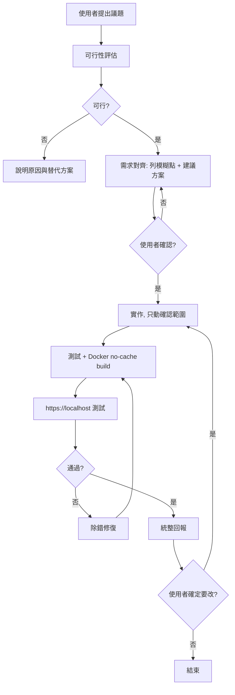

# 自動化滲透測試系統 — 開發指引

## 1. 核心原則

| 原則 | 要求 |
|------|------|
| Clean Code | 命名清楚、小函式、單一職責 |
| PEP 8 Auto | `black` + `isort` + `ruff` 自動格式化 |
| 無註解 | 用命名與結構表達語意 |
| 物件導向 | 類別封裝,行為透過介面暴露 |
| 模組化 | 功能以獨立模組接入 |
| 高內聚低耦合 | 模組只做一件事,彼此靠介面溝通 |
| 安全 | 輸入不信任,API 不外露 |

---

## 2. 議題處理流程

使用者丟出議題後的標準順序,**可行性評估永遠在動手之前**。



可行性評估輸出:

```markdown
## 可行性評估：{{議題}}
- 結論：可行 / 不建議
- 影響模組：
- 風險：
- 建議方案（Top 3）：
- 需你決策的點：
```

---

## 3. 變更控制

> **只改使用者確定的問題。舊有程式碼未經詢問不得更動。**

| 規則 | 說明 |
|------|------|
| 先問再改 | 要動既有程式碼,先說明改哪、為何改,經同意才動 |
| 最小變更 | 只改與議題直接相關的部分,不順手重構 |
| 沿用舊風格 | 既有命名、分層、前端樣式優先沿用 |
| 範圍外另記 | 其他問題用清單回報,不併入本次 |

---

## 4. 程式碼規範

工具:`black`、`isort`、`ruff`(含複雜度 C901 < 10)、`mypy --strict`、`bandit`、`pytest`。

| 類型 | 格式 | 範例 |
|------|------|------|
| 模組 | `snake_case` | `scanner.py` |
| 類別 | `PascalCase` | `ScanOrchestrator` |
| 函式/變數 | `snake_case` | `validate_target` |
| 常數 | `UPPER_SNAKE_CASE` | `MAX_CONCURRENCY` |

函式 ≤ 20 行、參數 ≤ 3、巢狀 ≤ 3 層。


## 6. 資安防護

系統要有基本防護,重點三件事:

| 項目 | 作法 |
|------|------|
| 防注入 | SQL 一律參數化查詢;外部程式用 `subprocess` 且 `shell=False`、參數以 list 傳;前端輸出 escape(防 XSS) |
| 防路徑穿越 | 檔案路徑正規化後檢查,拒絕 `../`、`..\\` |
| API 安全 | API Key 只留後端,不進前端、不進版控、不進日誌;前端透過後端呼叫 Claude |
|小心供應鏈攻擊| 使用PYPI 或其他npm套件請確認是否為官方，是否有CVE |
路徑檢查範例:

```python
from pathlib import Path

from ..domain.exceptions import InvalidPathError


def resolve_within(base: Path, user_path: str) -> Path:
    target = (base / user_path).resolve()
    if base.resolve() not in target.parents and target != base.resolve():
        raise InvalidPathError(user_path)
    return target
```

外部程式安全呼叫範例:

```python
import shutil
import subprocess

from ..domain.exceptions import ToolNotFoundError


def run_tool(binary: str, args: list[str]) -> str:
    resolved = shutil.which(binary)
    if resolved is None:
        raise ToolNotFoundError(binary)
    completed = subprocess.run(
        [resolved, *args],
        capture_output=True,
        text=True,
        timeout=300,
        check=False,
        shell=False,
    )
    return completed.stdout
```

API Key 讀取範例:

```python
import os

from ..domain.exceptions import MissingSecretError


class Settings:
    def __init__(self) -> None:
        self._claude_api_key = self._require("CLAUDE_API_KEY")

    @property
    def claude_api_key(self) -> str:
        return self._claude_api_key

    @staticmethod
    def _require(key: str) -> str:
        value = os.getenv(key)
        if not value:
            raise MissingSecretError(key)
        return value
```

---

## 7. 前端風格

若已有既有風格,**一律沿用**。新頁面才參考 Fortinet / NVIDIA / Apple:深色專業基調、留白清楚、嚴重度用顏色 + 圖示 + 文字並用(可及性),通過 WCAG AA 對比。

設計 token 集中管理:

```css
:root {
  --bg-base: #0b0e14;
  --bg-elevated: #151a23;
  --text-primary: #e6e9ef;
  --text-muted: #9aa4b2;
  --accent: #3b82f6;
  --severity-critical: #ef4444;
  --severity-high: #f97316;
  --severity-medium: #eab308;
  --severity-low: #22c55e;
}
```
UI / UX 可以參考這個網頁:
https://vercel.com/geist/button
---

## 8. 測試與部署

- 寫完程式碼一定跑測試,覆蓋率 ≥ 80%。
- 建置用 `docker build --no-cache`,容器以非 root 執行。
- 僅綁本地,Web 測試於 `https://localhost`。

```bash
docker build --no-cache -t {{SYSTEM_NAME}}:local -f docker/Dockerfile .
docker run -d --rm --name sut --env-file .env -p 127.0.0.1:443:8443 {{SYSTEM_NAME}}:local

for _ in $(seq 1 30); do
  curl -ksSf https://localhost/health >/dev/null && break
  sleep 1
done

PYTHONPATH=src pytest -q
docker stop sut
```

測試範例:

```python
from pathlib import Path

import pytest

from {{package}}.security.validation import resolve_within
from {{package}}.domain.exceptions import InvalidPathError


def test_resolve_within_valid(tmp_path: Path) -> None:
    (tmp_path / "a.txt").write_text("x")
    assert resolve_within(tmp_path, "a.txt").name == "a.txt"


@pytest.mark.parametrize("bad", ["../etc/passwd", "..\\win", "../../x"])
def test_resolve_within_traversal_raises(tmp_path: Path, bad: str) -> None:
    with pytest.raises(InvalidPathError):
        resolve_within(tmp_path, bad)
```

---

## 9. 問題回報

開發過程發現的問題,**統整後一次回報**,確定修改才進下一個 loop。

```markdown
## 本輪結果：{{議題}}
- 變更範圍：只改了 {{檔案}}；未動的舊程式碼：{{說明}}
- 測試：{{通過數}}、覆蓋率 {{xx}}%
- Docker build / https://localhost：{{通過/失敗}}

### 發現的問題
| 嚴重度 | 問題 | 建議 | 需你拍板 |
|--------|------|------|----------|

### 待你決策
- {{項目}} → 確定後我下一個 loop 處理
```

---

## 10. 附錄

### `pyproject.toml`(節錄)

```toml
[project]
name = "{{SYSTEM_NAME}}"
requires-python = ">=3.12"
dependencies = ["anthropic>=0.40"]

[project.optional-dependencies]
dev = ["black", "isort", "ruff", "mypy", "pytest", "pytest-cov", "bandit"]

[tool.ruff.lint]
select = ["E", "W", "F", "I", "N", "B", "C90", "UP", "S", "SIM", "RUF"]

[tool.ruff.lint.mccabe]
max-complexity = 9

[tool.mypy]
strict = true

[tool.coverage.report]
fail_under = 80
```

### `.env.example`

```bash
CLAUDE_API_KEY=replace-me
CLAUDE_MODEL=claude-sonnet-4-5
```

### `.gitignore`(重點)

```gitignore
.env
*.pem
*.key
__pycache__/
.coverage
```

### Agent 規範

```markdown
1. 收到議題先做可行性評估,再需求對齊,經我確認才動手。
2. 只改我確定的問題;舊程式碼未經詢問不得更動;沿用既有風格。
3. clean code、PEP 8 auto、OOP、模組化、高內聚低耦合、不寫註解。
4. 防注入(SQL/XSS/命令)、防路徑穿越(../)、API Key 不外露。
5. 寫完一定跑測試;docker --no-cache build;於 https://localhost 測試。
6. 問題統整回報,確定修改才進下一個 loop。
```
