# 系統開發規範指南（Development Guide）

> 本文件為通用模板，適用於 Python 專案。以 `{{ }}` 標示的欄位請依專案自行替換。
>
> - 專案名稱：`{{PROJECT_NAME}}`
> - 文件版本：`v1.0.0`
> - 維護者：`{{MAINTAINER}}`
> - 最後更新：`{{YYYY-MM-DD}}`

---

## 目錄

1. [文件目的與適用範圍](#1-文件目的與適用範圍)
2. [變更控制原則](#2-變更控制原則)
3. [開發流程（SDLC）](#3-開發流程sdlc)
4. [設計原則](#4-設計原則)
5. [程式碼風格規範](#5-程式碼風格規範)
6. [專案結構](#6-專案結構)
7. [系統設計圖（SD）](#7-系統設計圖sd)
8. [範例實作](#8-範例實作)
9. [測試設計](#9-測試設計)
10. [驗證與品質關卡](#10-驗證與品質關卡)
11. [Code Review 規範](#11-code-review-規範)
12. [Git 工作流程](#12-git-工作流程)
13. [需求追溯矩陣](#13-需求追溯矩陣)
14. [附錄：設定檔範本](#14-附錄設定檔範本)

---

## 1. 文件目的與適用範圍

| 項目 | 說明 |
|------|------|
| 目的 | 統一團隊開發標準，確保程式碼品質、可測試性與可維護性 |
| 適用對象 | 開發人員、Reviewer、QA、AI 協作工具 |
| 適用語言 | Python 3.11+ |
| 核心要求 | Clean Code、PEP 8、自動格式化、高內聚低耦合、測試覆蓋率 > 80% |

---

## 2. 變更控制原則

> **最高原則：只改需求明確要求的部分。**

### 2.1 既有程式碼修改規則

| 規則 | 說明 |
|------|------|
| R1 先確認再修改 | 涉及既有程式碼時，必須先向需求提出者說明「要改哪裡、為什麼改」，經同意後才修改 |
| R2 最小變更 | 一個需求只改與該需求直接相關的程式碼，禁止順手重構、改命名、調格式以外的邏輯 |
| R3 範圍外問題另提 | Review 時發現的其他問題，以建議清單或 Issue 回報，不直接併入本次變更 |
| R4 可追溯 | 每次變更須對應需求編號（`REQ-xxx`）或 Issue 編號 |
| R5 可回復 | 每次變更為獨立 commit / PR，可單獨 revert |

### 2.2 變更流程

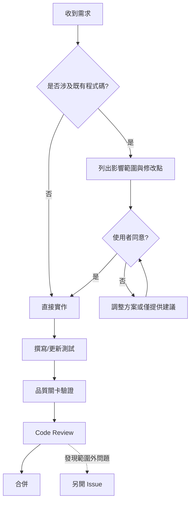

### 2.3 變更提案範本

```markdown
## 變更提案 CR-{{編號}}

- 對應需求：REQ-{{編號}}
- 影響檔案：
  - `src/{{module}}/{{file}}.py`：{{修改內容}}
- 修改原因：{{原因}}
- 不修改的部分：{{明確列出不會動的範圍}}
- 風險評估：{{低/中/高}}，{{說明}}
- 測試計畫：{{新增/修改的測試案例}}
```

---

## 3. 開發流程（SDLC）

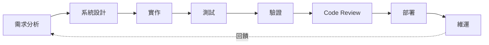

| 階段 | 產出物 | 負責人 | 完成條件 |
|------|--------|--------|----------|
| 需求分析 | 需求規格（REQ） | PM / SA | 需求可驗收、可測試 |
| 系統設計 | 架構圖、SD 圖、介面定義 | SA / Tech Lead | 設計審查通過 |
| 實作 | 原始碼 | Developer | 通過格式與靜態檢查 |
| 測試 | 測試程式、測試報告 | Developer / QA | 覆蓋率 > 80%，全數通過 |
| 驗證 | CI 報告 | CI | 所有品質關卡通過 |
| Code Review | Review 紀錄 | Reviewer | 無 Blocker |
| 部署 | Release Note | DevOps | 部署驗證通過 |

---

## 4. 設計原則

### 4.1 SOLID

| 原則 | 說明 | 實踐方式 |
|------|------|----------|
| S 單一職責 | 一個類別只有一個變更理由 | Service、Repository、Validator 分離 |
| O 開放封閉 | 對擴充開放、對修改封閉 | 透過 `Protocol` / 策略模式擴充 |
| L 里氏替換 | 子型別可替換父型別 | 實作需完整遵守介面契約 |
| I 介面隔離 | 介面小而專一 | 拆分讀寫介面 |
| D 依賴反轉 | 依賴抽象而非實作 | 建構子注入（Constructor Injection） |

### 4.2 高內聚、低耦合

| 指標 | 要求 |
|------|------|
| 內聚 | 同一模組內的函式服務同一目的；模組名稱即可說明其職責 |
| 耦合 | 模組間僅透過介面（`Protocol`）溝通；禁止跨層直接存取 |
| 依賴方向 | `interfaces → application → domain`，`infrastructure → domain`；domain 不依賴任何外層 |
| 全域狀態 | 禁止可變全域變數，設定以物件注入 |

### 4.3 Clean Code 規則

| 項目 | 規則 |
|------|------|
| 命名 | 名稱表達意圖；函式用動詞（`create_user`），類別用名詞（`UserService`） |
| 函式長度 | 建議 ≤ 20 行，單一層級抽象 |
| 參數數量 | ≤ 3 個，超過以 `dataclass` 封裝 |
| 圈複雜度 | 每個函式 < 10 |
| 巢狀深度 | ≤ 3 層，優先使用 guard clause 提早返回 |
| 註解 | 以清楚的命名與結構取代註解；程式碼本身即文件 |
| 魔術數字 | 一律抽為具名常數或 `Enum` |
| 例外處理 | 捕捉具體例外，禁止 `except:` 與 `except Exception: pass` |
| 型別 | 所有公開函式須有完整 type hints |

---

## 5. 程式碼風格規範

### 5.1 工具鏈

| 工具 | 用途 | 執行時機 |
|------|------|----------|
| `black` | 自動格式化（PEP 8） | pre-commit / CI |
| `isort` | import 排序 | pre-commit / CI |
| `ruff` | Lint、PEP 8、複雜度（C901） | pre-commit / CI |
| `mypy` | 靜態型別檢查（strict） | pre-commit / CI |
| `bandit` | 安全性掃描 | CI |
| `pip-audit` | 相依套件漏洞掃描 | CI |
| `pytest` + `pytest-cov` | 測試與覆蓋率 | CI |
| `radon` | 圈複雜度報告 | CI |

### 5.2 本機指令

```bash
pip install -e ".[dev]"
pre-commit install
black src tests
isort src tests
ruff check src tests --fix
mypy src
pytest --cov=src --cov-fail-under=80
```

### 5.3 命名規範

| 類型 | 格式 | 範例 |
|------|------|------|
| 模組 / 套件 | `snake_case` | `user_service.py` |
| 類別 | `PascalCase` | `UserRepository` |
| 函式 / 變數 | `snake_case` | `find_by_email` |
| 常數 | `UPPER_SNAKE_CASE` | `MAX_RETRY_COUNT` |
| 私有成員 | 前綴 `_` | `_hash_password` |
| 測試函式 | `test_<對象>_<情境>_<預期>` | `test_register_duplicate_email_raises_error` |

---

## 6. 專案結構

採用分層架構（Clean Architecture）：

```text
{{PROJECT_NAME}}/
├── src/
│   └── {{package}}/
│       ├── domain/
│       │   ├── models.py
│       │   ├── exceptions.py
│       │   └── ports.py
│       ├── application/
│       │   └── services.py
│       ├── infrastructure/
│       │   ├── repositories.py
│       │   └── security.py
│       ├── interfaces/
│       │   └── api.py
│       ├── config.py
│       └── container.py
├── tests/
│   ├── unit/
│   ├── integration/
│   ├── e2e/
│   └── conftest.py
├── docs/
├── .github/
│   └── workflows/
│       └── ci.yml
├── .pre-commit-config.yaml
├── pyproject.toml
├── DEVELOPMENT_GUIDE.md
└── README.md
```

| 層級 | 職責 | 可依賴 |
|------|------|--------|
| `domain` | 實體、業務規則、介面（ports） | 無 |
| `application` | 使用案例協調 | `domain` |
| `infrastructure` | 資料庫、外部服務、加密實作 | `domain` |
| `interfaces` | API / CLI 進入點 | `application` |
| `container` | 組裝依賴（Composition Root） | 全部 |

---

## 7. 系統設計圖（SD）

> GitHub 原生支援 Mermaid，下列圖表可直接渲染。請依專案替換實體與流程。

### 7.1 系統架構圖（Component Diagram）

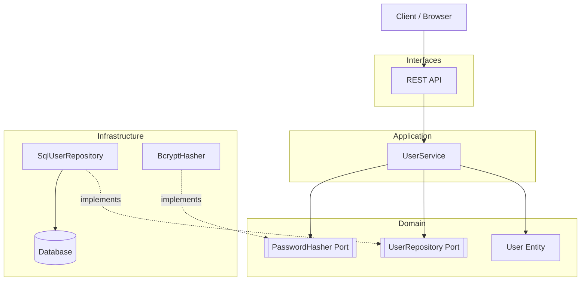

### 7.2 類別圖（Class Diagram）

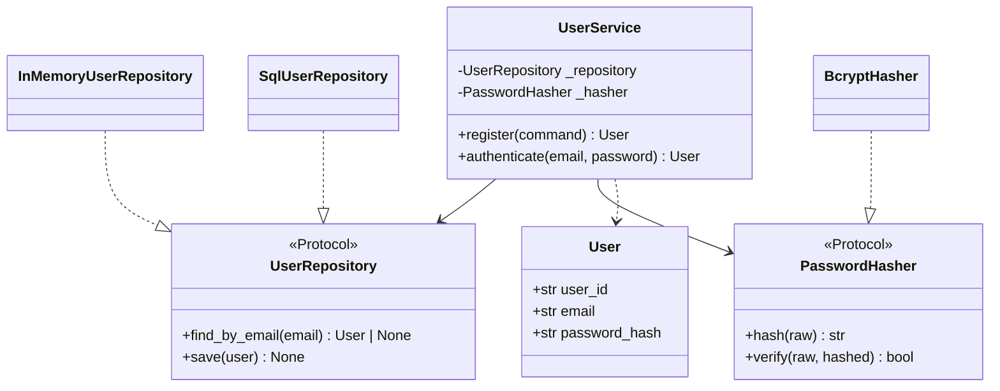

### 7.3 循序圖（Sequence Diagram）：使用者註冊

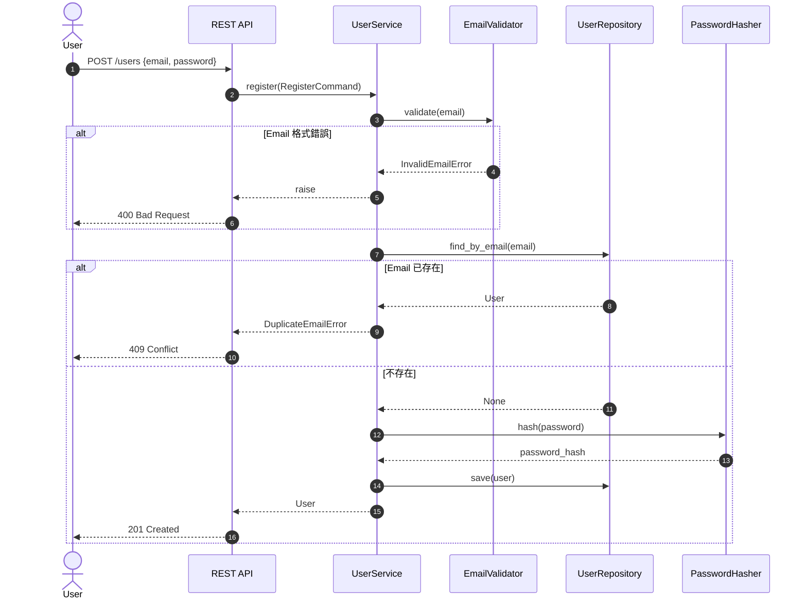

### 7.4 狀態圖（State Diagram）：帳號生命週期

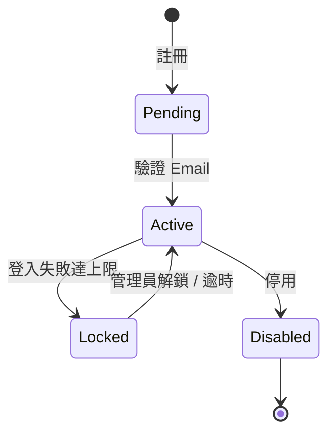

### 7.5 ER 圖（Entity Relationship）

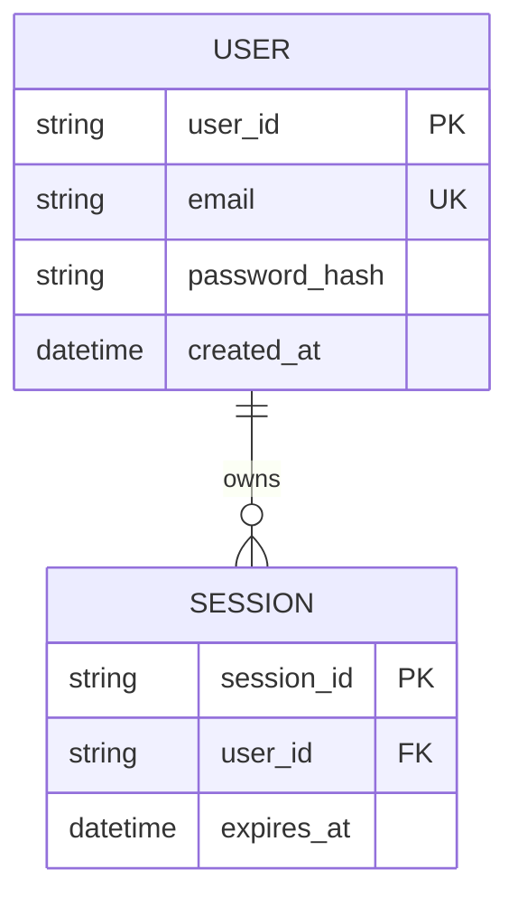

### 7.6 部署圖（Deployment）

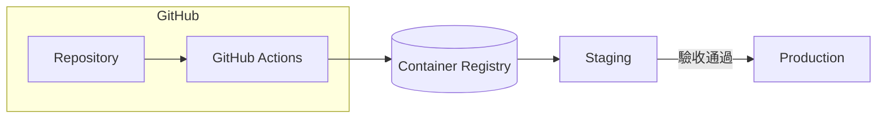

---

## 8. 範例實作

> 示範依賴反轉、建構子注入與小函式設計。所有範例皆通過 `black`、`isort`、`ruff`、`mypy --strict`。

### 8.1 `domain/models.py`

```python
from dataclasses import dataclass


@dataclass(frozen=True)
class User:
    user_id: str
    email: str
    password_hash: str


@dataclass(frozen=True)
class RegisterCommand:
    email: str
    password: str
```

### 8.2 `domain/exceptions.py`

```python
class DomainError(Exception):
    pass


class InvalidEmailError(DomainError):
    pass


class WeakPasswordError(DomainError):
    pass


class DuplicateEmailError(DomainError):
    pass


class AuthenticationError(DomainError):
    pass
```

### 8.3 `domain/ports.py`

```python
from typing import Protocol

from .models import User


class UserRepository(Protocol):
    def find_by_email(self, email: str) -> User | None: ...

    def save(self, user: User) -> None: ...


class PasswordHasher(Protocol):
    def hash(self, raw: str) -> str: ...

    def verify(self, raw: str, hashed: str) -> bool: ...


class IdGenerator(Protocol):
    def generate(self) -> str: ...
```

### 8.4 `domain/validators.py`

```python
import re

from .exceptions import InvalidEmailError, WeakPasswordError

EMAIL_PATTERN = re.compile(r"^[\w.+-]+@[\w-]+\.[\w.-]+$")
MIN_PASSWORD_LENGTH = 8
MAX_PASSWORD_LENGTH = 128


def validate_email(email: str) -> str:
    normalized = email.strip().lower()
    if not EMAIL_PATTERN.fullmatch(normalized):
        raise InvalidEmailError(email)
    return normalized


def validate_password(password: str) -> None:
    if not MIN_PASSWORD_LENGTH <= len(password) <= MAX_PASSWORD_LENGTH:
        raise WeakPasswordError("password length out of range")
    if password.isalpha() or password.isdigit():
        raise WeakPasswordError("password must mix letters and digits")
```

### 8.5 `application/services.py`

```python
from ..domain.exceptions import AuthenticationError, DuplicateEmailError
from ..domain.models import RegisterCommand, User
from ..domain.ports import IdGenerator, PasswordHasher, UserRepository
from ..domain.validators import validate_email, validate_password


class UserService:
    def __init__(
        self,
        repository: UserRepository,
        hasher: PasswordHasher,
        id_generator: IdGenerator,
    ) -> None:
        self._repository = repository
        self._hasher = hasher
        self._id_generator = id_generator

    def register(self, command: RegisterCommand) -> User:
        email = validate_email(command.email)
        validate_password(command.password)
        self._ensure_email_available(email)
        user = User(
            user_id=self._id_generator.generate(),
            email=email,
            password_hash=self._hasher.hash(command.password),
        )
        self._repository.save(user)
        return user

    def authenticate(self, email: str, password: str) -> User:
        user = self._repository.find_by_email(validate_email(email))
        if user is None or not self._hasher.verify(password, user.password_hash):
            raise AuthenticationError("invalid credentials")
        return user

    def _ensure_email_available(self, email: str) -> None:
        if self._repository.find_by_email(email) is not None:
            raise DuplicateEmailError(email)
```

### 8.6 `infrastructure/repositories.py`

```python
from ..domain.models import User


class InMemoryUserRepository:
    def __init__(self) -> None:
        self._users: dict[str, User] = {}

    def find_by_email(self, email: str) -> User | None:
        return self._users.get(email)

    def save(self, user: User) -> None:
        self._users[user.email] = user
```

### 8.7 `infrastructure/security.py`

```python
import hashlib
import hmac
import secrets
import uuid

PBKDF2_ALGORITHM = "sha256"
PBKDF2_ITERATIONS = 600_000
SALT_BYTES = 16


class Pbkdf2Hasher:
    def hash(self, raw: str) -> str:
        salt = secrets.token_hex(SALT_BYTES)
        return f"{salt}${self._derive(raw, salt)}"

    def verify(self, raw: str, hashed: str) -> bool:
        salt, expected = hashed.split("$", maxsplit=1)
        return hmac.compare_digest(self._derive(raw, salt), expected)

    @staticmethod
    def _derive(raw: str, salt: str) -> str:
        digest = hashlib.pbkdf2_hmac(
            PBKDF2_ALGORITHM,
            raw.encode(),
            salt.encode(),
            PBKDF2_ITERATIONS,
        )
        return digest.hex()


class UuidGenerator:
    def generate(self) -> str:
        return uuid.uuid4().hex
```

### 8.8 `container.py`（Composition Root）

```python
from .application.services import UserService
from .infrastructure.repositories import InMemoryUserRepository
from .infrastructure.security import Pbkdf2Hasher, UuidGenerator


def build_user_service() -> UserService:
    return UserService(
        repository=InMemoryUserRepository(),
        hasher=Pbkdf2Hasher(),
        id_generator=UuidGenerator(),
    )
```

---

## 9. 測試設計

### 9.1 測試金字塔

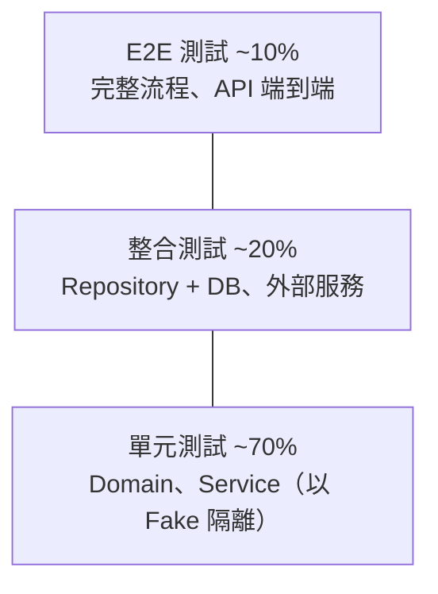

| 層級 | 範圍 | 工具 | 執行時間要求 |
|------|------|------|--------------|
| 單元 | 單一函式 / 類別，相依以 Fake/Stub 取代 | `pytest` | 全部 < 10 秒 |
| 整合 | 跨模組、真實 DB（容器） | `pytest` + `testcontainers` | < 2 分鐘 |
| E2E | API 完整流程 | `pytest` + `httpx` | < 5 分鐘 |

### 9.2 測試設計技術

| 技術 | 用途 | 範例 |
|------|------|------|
| 等價類劃分 | 將輸入分為有效 / 無效類別 | 合法 Email、缺 `@`、缺網域 |
| 邊界值分析 | 測試邊界前後 | 密碼長度 7 / 8 / 128 / 129 |
| 決策表 | 多條件組合 | Email 存在 × 密碼正確 |
| 狀態轉移 | 驗證狀態機 | Pending → Active → Locked |
| 錯誤推測 | 經驗性異常 | 空字串、前後空白、大小寫 |

### 9.3 測試案例表（範例）

| 編號 | 需求 | 測試對象 | 前置條件 | 輸入 | 預期結果 | 類型 |
|------|------|----------|----------|------|----------|------|
| TC-001 | REQ-001 | `register` | 無使用者 | 合法 email / 密碼 | 建立成功，密碼已雜湊 | 正向 |
| TC-002 | REQ-001 | `register` | email 已存在 | 相同 email | `DuplicateEmailError` | 負向 |
| TC-003 | REQ-002 | `validate_email` | – | `abc` | `InvalidEmailError` | 等價類 |
| TC-004 | REQ-002 | `validate_email` | – | `  A@B.COM ` | 回傳 `a@b.com` | 錯誤推測 |
| TC-005 | REQ-003 | `validate_password` | – | 長度 7 | `WeakPasswordError` | 邊界值 |
| TC-006 | REQ-003 | `validate_password` | – | 長度 8 混合 | 通過 | 邊界值 |
| TC-007 | REQ-003 | `validate_password` | – | 長度 129 | `WeakPasswordError` | 邊界值 |
| TC-008 | REQ-003 | `validate_password` | – | 純字母 | `WeakPasswordError` | 等價類 |
| TC-009 | REQ-004 | `authenticate` | 使用者存在 | 正確密碼 | 回傳 User | 決策表 |
| TC-010 | REQ-004 | `authenticate` | 使用者存在 | 錯誤密碼 | `AuthenticationError` | 決策表 |
| TC-011 | REQ-004 | `authenticate` | 無使用者 | 任意 | `AuthenticationError` | 決策表 |
| TC-012 | REQ-005 | `Pbkdf2Hasher` | – | 同密碼雜湊兩次 | 結果不同但皆可驗證 | 安全 |

### 9.4 測試程式範例

#### `tests/conftest.py`

```python
import pytest

from {{package}}.application.services import UserService
from {{package}}.infrastructure.repositories import InMemoryUserRepository
from {{package}}.infrastructure.security import Pbkdf2Hasher


class SequentialIdGenerator:
    def __init__(self) -> None:
        self._counter = 0

    def generate(self) -> str:
        self._counter += 1
        return f"user-{self._counter}"


@pytest.fixture
def repository() -> InMemoryUserRepository:
    return InMemoryUserRepository()


@pytest.fixture
def service(repository: InMemoryUserRepository) -> UserService:
    return UserService(repository, Pbkdf2Hasher(), SequentialIdGenerator())
```

#### `tests/unit/test_validators.py`

```python
import pytest

from {{package}}.domain.exceptions import InvalidEmailError, WeakPasswordError
from {{package}}.domain.validators import validate_email, validate_password


@pytest.mark.parametrize("email", ["abc", "a@", "@b.com", "a b@c.com", ""])
def test_validate_email_invalid_format_raises_error(email: str) -> None:
    with pytest.raises(InvalidEmailError):
        validate_email(email)


def test_validate_email_normalizes_case_and_whitespace() -> None:
    assert validate_email("  A@B.COM ") == "a@b.com"


@pytest.mark.parametrize(
    "password", ["abc1234", "a1" * 64 + "x", "abcdefgh", "12345678"]
)
def test_validate_password_invalid_raises_error(password: str) -> None:
    with pytest.raises(WeakPasswordError):
        validate_password(password)


@pytest.mark.parametrize("password", ["abcd1234", "a1" * 64])
def test_validate_password_boundary_valid(password: str) -> None:
    validate_password(password)
```

#### `tests/unit/test_user_service.py`

```python
import pytest

from {{package}}.application.services import UserService
from {{package}}.domain.exceptions import AuthenticationError, DuplicateEmailError
from {{package}}.domain.models import RegisterCommand

VALID_EMAIL = "alice@example.com"
VALID_PASSWORD = "secret123"


def register_default(service: UserService) -> None:
    service.register(RegisterCommand(VALID_EMAIL, VALID_PASSWORD))


def test_register_valid_command_returns_user(service: UserService) -> None:
    user = service.register(RegisterCommand(VALID_EMAIL, VALID_PASSWORD))
    assert user.email == VALID_EMAIL
    assert user.password_hash != VALID_PASSWORD


def test_register_duplicate_email_raises_error(service: UserService) -> None:
    register_default(service)
    with pytest.raises(DuplicateEmailError):
        register_default(service)


def test_authenticate_correct_password_returns_user(service: UserService) -> None:
    register_default(service)
    assert service.authenticate(VALID_EMAIL, VALID_PASSWORD).email == VALID_EMAIL


@pytest.mark.parametrize(
    ("email", "password"),
    [(VALID_EMAIL, "wrong1234"), ("nobody@example.com", VALID_PASSWORD)],
)
def test_authenticate_invalid_credentials_raises_error(
    service: UserService, email: str, password: str
) -> None:
    register_default(service)
    with pytest.raises(AuthenticationError):
        service.authenticate(email, password)
```

#### `tests/unit/test_security.py`

```python
from {{package}}.infrastructure.security import Pbkdf2Hasher


def test_hash_same_password_produces_unique_salted_hashes() -> None:
    hasher = Pbkdf2Hasher()
    first, second = hasher.hash("secret123"), hasher.hash("secret123")
    assert first != second
    assert hasher.verify("secret123", first)
    assert hasher.verify("secret123", second)


def test_verify_wrong_password_returns_false() -> None:
    hasher = Pbkdf2Hasher()
    assert not hasher.verify("wrong1234", hasher.hash("secret123"))
```

### 9.5 測試撰寫規則

| 規則 | 說明 |
|------|------|
| AAA 結構 | Arrange → Act → Assert，以空行或輔助函式區隔 |
| 獨立性 | 測試之間不共享狀態，順序可任意 |
| 一測一行為 | 每個測試只驗證一個行為 |
| 以 Fake 取代 Mock | 優先使用實作介面的 Fake 物件，降低對實作細節的耦合 |
| 參數化 | 等價類 / 邊界值使用 `pytest.mark.parametrize` |
| 命名 | `test_<對象>_<情境>_<預期>` |
| 不測私有方法 | 透過公開介面驗證行為 |

---

## 10. 驗證與品質關卡

### 10.1 品質關卡（Quality Gates）

| 關卡 | 工具 | 通過標準 | 失敗處理 |
|------|------|----------|----------|
| 格式化 | `black --check`、`isort --check` | 無差異 | 阻擋合併 |
| Lint | `ruff check` | 0 錯誤 | 阻擋合併 |
| 型別 | `mypy --strict` | 0 錯誤 | 阻擋合併 |
| 複雜度 | `ruff` C901 / `radon cc` | 每函式 < 10 | 阻擋合併 |
| 單元 / 整合測試 | `pytest` | 100% 通過 | 阻擋合併 |
| 覆蓋率 | `pytest-cov` | ≥ 80%（line + branch） | 阻擋合併 |
| 安全掃描 | `bandit` | 無 High / Medium | 阻擋合併 |
| 相依漏洞 | `pip-audit` | 無已知漏洞 | 阻擋合併 |
| Code Review | GitHub PR | ≥ 1 位核准、無 Blocker | 阻擋合併 |

### 10.2 驗證流程

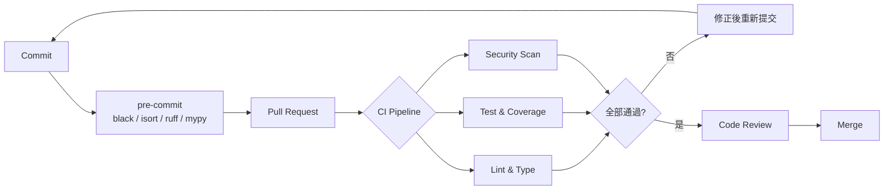

### 10.3 驗收標準（Definition of Done）

- [ ] 需求功能完成且符合驗收條件
- [ ] 僅修改需求範圍內的程式碼（符合第 2 章）
- [ ] 所有品質關卡通過
- [ ] 新增 / 修改功能皆有對應測試
- [ ] SD 圖與文件已同步更新
- [ ] 需求追溯矩陣已更新
- [ ] Code Review 核准

---

## 11. Code Review 規範

### 11.1 審查流程

1. 確認本次變更對應的需求與 Code Review 標準
2. 審查程式碼變更、設計模式與架構決策
3. 分析程式碼品質、安全性、效能與可維護性
4. 提供具體、可執行的改進建議

### 11.2 審查清單

#### 必要項目

- [ ] 無嚴重安全問題
- [ ] 測試覆蓋率 > 80%
- [ ] 圈複雜度 < 10
- [ ] 無高優先權漏洞
- [ ] 文件完整清晰
- [ ] 無明顯 code smell
- [ ] 效能影響已驗證
- [ ] 遵循最佳實踐
- [ ] 變更範圍與需求一致，無範圍外修改

#### 程式碼品質

| 項目 | 檢查重點 |
|------|----------|
| 邏輯正確性 | 邊界條件、空值、例外路徑 |
| 錯誤處理 | 具體例外、不吞例外、錯誤訊息不洩漏敏感資訊 |
| 資源管理 | 使用 `with` 管理檔案、連線、鎖 |
| 命名 | 表達意圖、一致 |
| 組織 | 分層正確、無循環相依 |
| 函式複雜度 | 長度、參數數、巢狀深度 |
| 重複 | 無複製貼上程式碼（DRY） |
| 可讀性 | 無須註解即可理解 |

#### 安全性

| 項目 | 檢查重點 |
|------|----------|
| 輸入驗證 | 所有外部輸入皆經驗證與正規化 |
| 身分驗證 | 密碼雜湊（PBKDF2 / bcrypt / argon2）、常數時間比較 |
| 授權 | 每個操作檢查權限 |
| 注入攻擊 | 參數化查詢，禁止字串拼接 SQL / Shell |
| 加密 | 使用 `secrets`，禁止 `random` 產生安全相關值 |
| 敏感資料 | 不寫入 log、不硬編碼於程式碼，使用環境變數 / Secret Manager |
| 相依套件 | `pip-audit` 無已知漏洞、版本鎖定 |
| 設定 | Debug 模式關閉、預設最小權限 |

### 11.3 意見分級

| 等級 | 標記 | 說明 | 是否阻擋合併 |
|------|------|------|--------------|
| Blocker | `[BLOCKER]` | 安全漏洞、錯誤邏輯、破壞既有功能 | 是 |
| Major | `[MAJOR]` | 設計問題、缺少測試、違反規範 | 是 |
| Minor | `[MINOR]` | 命名、可讀性改進 | 否 |
| Suggestion | `[SUGGEST]` | 範圍外建議，另開 Issue | 否 |

### 11.4 Review 報告範本

```markdown
## Code Review 報告

- PR：#{{編號}}
- 對應需求：REQ-{{編號}}
- Reviewer：{{name}}

### 摘要
{{整體評價}}

### 檢查結果
| 項目 | 結果 | 備註 |
|------|------|------|
| 安全性 | ✅ / ❌ | |
| 覆蓋率 | {{xx}}% | |
| 最大圈複雜度 | {{n}} | |
| 變更範圍 | ✅ 符合需求 | |

### 問題清單
| 等級 | 檔案:行號 | 問題 | 建議 |
|------|-----------|------|------|
| [MAJOR] | `services.py:42` | {{問題}} | {{建議}} |

### 範圍外建議（不併入本次變更）
- {{建議}} → Issue #{{編號}}
```

---

## 12. Git 工作流程

### 12.1 分支策略

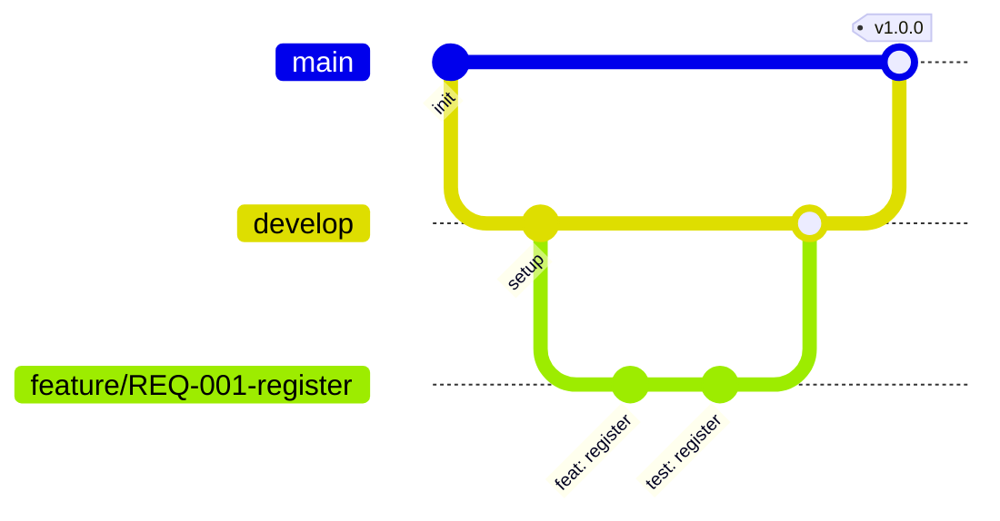

| 分支 | 用途 | 命名 |
|------|------|------|
| `main` | 正式版本 | – |
| `develop` | 整合開發 | – |
| `feature/*` | 新功能 | `feature/REQ-001-short-desc` |
| `fix/*` | 錯誤修正 | `fix/ISSUE-12-short-desc` |
| `hotfix/*` | 緊急修正 | `hotfix/short-desc` |

### 12.2 Commit 規範（Conventional Commits）

```text
<type>(<scope>): <subject>

<body>

Refs: REQ-001
```

| type | 說明 |
|------|------|
| `feat` | 新功能 |
| `fix` | 錯誤修正 |
| `refactor` | 重構（不改變行為，須事先經同意） |
| `test` | 測試 |
| `docs` | 文件 |
| `chore` | 建置、工具設定 |
| `perf` | 效能改進 |
| `security` | 安全性修正 |

### 12.3 PR 範本（`.github/pull_request_template.md`）

```markdown
## 變更說明
{{描述}}

## 對應需求
- REQ-{{編號}} / Issue #{{編號}}

## 變更範圍
- [ ] 僅修改需求相關檔案
- [ ] 涉及既有程式碼且已取得同意（CR-{{編號}}）

## 測試
- [ ] 新增 / 更新單元測試
- [ ] 覆蓋率 ≥ 80%

## 檢查
- [ ] 品質關卡全部通過
- [ ] SD 圖 / 文件已更新
```

---

## 13. 需求追溯矩陣

| 需求編號 | 需求描述 | 設計（SD） | 實作模組 | 測試案例 | 狀態 |
|----------|----------|------------|----------|----------|------|
| REQ-001 | 使用者可註冊帳號 | 7.3 循序圖 | `application/services.py` | TC-001、TC-002 | ✅ |
| REQ-002 | Email 格式驗證與正規化 | 7.3 | `domain/validators.py` | TC-003、TC-004 | ✅ |
| REQ-003 | 密碼強度檢查 | 7.3 | `domain/validators.py` | TC-005 ~ TC-008 | ✅ |
| REQ-004 | 使用者登入驗證 | 7.2 類別圖 | `application/services.py` | TC-009 ~ TC-011 | ✅ |
| REQ-005 | 密碼安全雜湊 | 7.1 架構圖 | `infrastructure/security.py` | TC-012 | ✅ |
| `{{REQ-xxx}}` | `{{描述}}` | `{{圖}}` | `{{模組}}` | `{{TC}}` | ⬜ |

---

## 14. 附錄：設定檔範本

### 14.1 `pyproject.toml`

```toml
[build-system]
requires = ["setuptools>=68", "wheel"]
build-backend = "setuptools.build_meta"

[project]
name = "{{PROJECT_NAME}}"
version = "0.1.0"
requires-python = ">=3.11"
dependencies = []

[project.optional-dependencies]
dev = [
    "black>=24.0",
    "isort>=5.13",
    "ruff>=0.6",
    "mypy>=1.11",
    "pytest>=8.0",
    "pytest-cov>=5.0",
    "bandit>=1.7",
    "pip-audit>=2.7",
    "radon>=6.0",
    "pre-commit>=3.8",
]

[tool.setuptools.packages.find]
where = ["src"]

[tool.black]
line-length = 88
target-version = ["py311"]

[tool.isort]
profile = "black"
line_length = 88

[tool.ruff]
line-length = 88
target-version = "py311"

[tool.ruff.lint]
select = ["E", "W", "F", "I", "N", "B", "C90", "UP", "S", "SIM", "RUF"]

[tool.ruff.lint.mccabe]
max-complexity = 9

[tool.ruff.lint.per-file-ignores]
"tests/**" = ["S101", "S105", "S106"]

[tool.mypy]
python_version = "3.11"
strict = true

[tool.pytest.ini_options]
testpaths = ["tests"]
addopts = "-ra --strict-markers"

[tool.coverage.run]
branch = true
source = ["src"]

[tool.coverage.report]
fail_under = 80
show_missing = true
```

### 14.2 `.pre-commit-config.yaml`

```yaml
repos:
  - repo: https://github.com/psf/black
    rev: 24.8.0
    hooks:
      - id: black
  - repo: https://github.com/pycqa/isort
    rev: 5.13.2
    hooks:
      - id: isort
  - repo: https://github.com/astral-sh/ruff-pre-commit
    rev: v0.6.9
    hooks:
      - id: ruff
        args: [--fix]
  - repo: https://github.com/pre-commit/mirrors-mypy
    rev: v1.11.2
    hooks:
      - id: mypy
        args: [--strict]
        files: ^src/
```

### 14.3 `.github/workflows/ci.yml`

```yaml
name: CI

on:
  push:
    branches: [main, develop]
  pull_request:

permissions:
  contents: read

jobs:
  quality:
    runs-on: ubuntu-latest
    strategy:
      matrix:
        python-version: ["3.11", "3.12"]
    steps:
      - uses: actions/checkout@v4
      - uses: actions/setup-python@v5
        with:
          python-version: ${{ matrix.python-version }}
          cache: pip
      - name: Install
        run: pip install -e ".[dev]"
      - name: Format
        run: |
          black --check src tests
          isort --check-only src tests
      - name: Lint
        run: ruff check src tests
      - name: Type check
        run: mypy src
      - name: Complexity
        run: radon cc src -n C --total-average
      - name: Test
        run: pytest --cov=src --cov-report=xml --cov-fail-under=80
      - name: Security
        run: |
          bandit -r src -ll
          pip-audit
```

---

## 修訂紀錄

| 版本 | 日期 | 修改者 | 說明 |
|------|------|--------|------|
| v1.0.0 | `{{YYYY-MM-DD}}` | `{{name}}` | 初版建立 |
